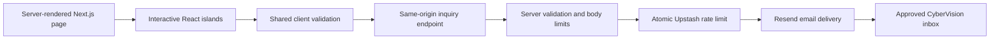

# CyberVision International — Website Remake

A complete Next.js App Router implementation with a dark design system, an interactive React Three Fiber hero, original project artwork, accessible product tabs, an animated innovation reel, impact counters, training and startup sections, and a multi-step consultation flow.

GitHub destination: https://github.com/SyedBaqirHashmi/cybervision-remake

## Quick start

Use Node.js 22.18+ (Node 24 LTS is also supported).

```bash
npm install
cp .env.example .env.local
npm run dev
```

Open http://localhost:3000. `NEXT_PUBLIC_SITE_URL` must match the origin in your browser for form submissions. After the first successful installation, commit the generated `package-lock.json` and use `npm ci` in CI and deployments.

```bash
npm run test
npm run typecheck
npm run build
npm start
```

The page and all local interactions work without external credentials. Sending enquiries and newsletter requests requires the email and rate-limiter configuration below. A missing integration returns an explicit unavailable response; the UI never reports a fabricated success.

## Project structure

```text
app/
  layout.tsx                 Metadata, self-hosted fonts, motion preferences
  page.tsx                   Server-rendered section composition and JSON-LD
  globals.css                Reusable design utilities and accessibility states
  api/inquiries/route.ts      Node runtime enquiry endpoint
  privacy/page.tsx           Data handling notice
  error.tsx                  Recoverable route error state
  not-found.tsx              404 page
  opengraph-image.tsx        Generated social preview
  robots.ts / sitemap.ts     Deployment-aware crawler metadata
components/
  header.tsx                 Glass navigation, section tracking, mobile menu
  hero/
    index.tsx                Server-rendered hero and primary calls to action
    network-visual.tsx       Progressive enhancement and static fallback
    neural-scene.tsx         Bounded 3D particle network
    innovation-reel.tsx      Original four-scene motion reel and controls
  bento-services.tsx         Pointer-driven light effects and service links
  metrics.tsx                One-time counters with screen-reader values
  showcase.tsx               Keyboard-operable enterprise project tabs
  training.tsx               Training and learning narrative
  startups.tsx               Animated, accessible capability accordions
  company.tsx                Company history and positioning
  contact.tsx                Office details and location illustration
  contact-form/index.tsx     Three-step validated consultation flow
  newsletter.tsx             Consent-based subscription request
  footer.tsx                 Navigation, corporate details and verified LinkedIn
  ui/                        Motion, magnetic link, logo, visual error boundary
lib/
  content.ts                 Verified company facts, project content and contacts
  inquiry.ts                 Shared validation and typed enquiry model
  lead-handler.ts            Origin checks, body limits, rate limiting, email
  site.ts                    Canonical origin handling
public/images/               Six original, self-hosted SVG illustrations
scripts/generate-assets.mjs  Reproducible source for the artwork
tests/                       Validation, request-handler, browser and a11y tests
tailwind.config.js           Colour, type, animation and glow extensions
```

## Design system

| Token | Use |
| --- | --- |
| `obsidian` / `#030712` | Primary canvas |
| `midnight` / `#0f172a` | Surface and form backgrounds |
| `electric` / `#06b6d4` | Decorative glow and borders |
| `neon` / `#6366f1` | Decorative indigo highlights |
| `cyan-200` / `#a5f3fc` | Accessible bright calls to action and text |
| `slate-100` / `#f1f5f9` | Main text |
| `slate-400` / `#94a3b8` | Supporting text on dark surfaces |

Inter is served from the application through `@fontsource/inter`; there are no Google Fonts requests. The display scale is fluid from 320px to desktop. Bright cyan buttons use dark text. Decorative saturated cyan and indigo are not used as small body text.

Motion responds to `prefers-reduced-motion`. Interactive targets expose focus rings and active states. The page uses real headings, labelled form controls, native radio inputs and checkboxes, a native modal dialog, roving tab focus, and error/status announcements.

## Email delivery and rate limiting

1. Create a Resend account and verify a sending domain you control.
2. Set `RESEND_API_KEY`, `MAIL_FROM` (for example a mailbox on that verified domain), and `CONTACT_TO` to the approved destination inbox.
3. Create an Upstash Redis instance and set its HTTPS REST URL and token.
4. Generate a unique `RATE_LIMIT_SALT` with `openssl rand -hex 32`.
5. Set `NEXT_PUBLIC_SITE_URL` to the exact deployed origin, without a path.
6. Set `TRUSTED_IP_HEADER` only to a header your trusted deployment ingress overwrites. On Vercel, use `x-vercel-forwarded-for`. Do not trust arbitrary client-supplied forwarding headers on a self-hosted deployment. If no trustworthy header is available, leave this setting empty; all visitors share one rate-limit bucket.

Keep these values in the deployment provider’s encrypted environment settings, never in source control. Only the public origin is exposed to browser code.

The API accepts same-origin JSON POST requests, limits the entire body to 16 KiB, validates fields again on the server, rejects honeypot submissions, and atomically rate-limits requests in Redis. Limits are five consultation attempts or three newsletter attempts per 15 minutes per trusted source address. Redis stores a salted address hash, not the raw address. Network operations have timeouts and failures return actionable errors.

Resend receives plain-text email. User text is not interpreted as HTML. Stable idempotency keys include a request UUID and content hash to make retries safe. A success response requires a successful provider response containing an email ID; it confirms provider acceptance, not final inbox delivery.

Newsletter submissions send the team a **subscription request**. They do not silently add users to a marketing list. The UI and privacy notice describe that confirmation step. If you connect an email marketing platform later, add its confirmed opt-in flow and update the privacy notice.

## Assets and reel

All six production visuals are included under `public/images`; there are no missing image paths or remote stock-image dependencies. Regenerate them with:

```bash
node scripts/generate-assets.mjs
```

The FAO, LUMS, agriculture and warehouse visuals are original illustrative interfaces, explicitly labelled as illustrations. They are not represented as real client screenshots or live data. Company names are rendered as text rather than using unlicensed customer logo files.

The innovation reel is a finished, original four-scene motion presentation with play/pause, previous/next, an accessible description and Escape dismissal. It has no audio and needs no missing video asset. Replace it with an approved corporate film only if one is supplied; preserve the dialog controls and add captions and a transcript for any narrated video.

The map is a local location illustration linked to Google Maps, so no third-party map scripts, tracking or API key are required. It is labelled as not to scale. Replace the illustration with an approved map service only after updating the privacy notice.

If adding photographic media, use local AVIF/WebP files with descriptive alt text and explicit dimensions through `next/image`. Keep the hero’s fixed aspect ratio to reserve space and avoid layout shifts.

## Architecture and performance

The App Router server-renders the page, metadata, content and structural markup. Only interactive sections are client components. No runtime AI provider is required for the marketing site.



Three.js is split into a dynamic chunk and starts after the hero enters view. Data Saver, reduced motion and unavailable WebGL keep the SVG fallback. The network contains 90 points and a bounded set of edges; DPR is capped at 1.5. Rendering pauses when offscreen, when the tab is hidden, or when the visitor pauses motion. No post-processing or large 3D models are used.

Project images have explicit dimensions and lazy loading. The page loads no analytics scripts or video embeds. Use your CDN’s caching for Next.js static assets. A Node-capable host is required for the form endpoint; this application is not a GitHub Pages static export.

## QA

```bash
npm run test
npm run typecheck
npm run build
npx playwright install chromium
npm run test:e2e
```

The browser suite checks 320px overflow, mobile navigation, keyboard project tabs, modal focus restoration, multi-step form validation, failed-delivery retry, successful-delivery rendering and automated WCAG AA checks. API tests use mocks and never send real email.

The GitHub Actions workflow runs unit tests, type checking, a production build and browser accessibility tests. Once the lockfile is generated, change its installation command to `npm ci`.

For release, measure the production build with Lighthouse on mobile and desktop. The target is 95+; this is a target, not a score already measured. Review keyboard and screen-reader behavior manually as well as running axe. Automated checks alone do not establish full WCAG compliance. Confirm real email delivery, trusted proxy configuration and privacy wording in the actual deployment environment.

## Content sources

Company facts were checked against these public sources on 12 October 2026:

- https://cybervision.com.pk/
- https://cybervision.com.pk/software-development-services/
- https://cybervision.com.pk/products/
- https://cybervision.com.pk/web-development/
- https://cybervision.com.pk/business-consulting/
- https://cybervision.com.pk/clients/
- https://cybervision.com.pk/contactus/
- https://www.linkedin.com/company/cybervision-international

The visible counters use company-published figures: 40,000+ youth trained, 850+ projects, four incubators/accelerators and 20+ years of experience since 2004. The suggested 20,000 jobs and 200 curricula were not independently supported by the checked pages and are not presented as facts.

## Implementation and release plan

1. **Complete source:** all sections, interactions, artwork, validation, delivery endpoint and tests are included.
2. **Install and lock:** install dependencies on a network-enabled machine; commit the resulting lockfile and run `npm run check`.
3. **Connect delivery:** configure the verified sender, inbox and Redis credentials, then test accepted, rejected, timeout and duplicate submissions in staging.
4. **Validate the experience:** run the browser suite, keyboard and screen-reader checks, responsive review, and production Lighthouse measurements.
5. **Release:** push to `SyedBaqirHashmi/cybervision-remake`, deploy to a Node-capable host, set the canonical origin, verify the real domain and email delivery, then publish.

See `VALIDATION.md` for checks actually completed in the current workspace.
